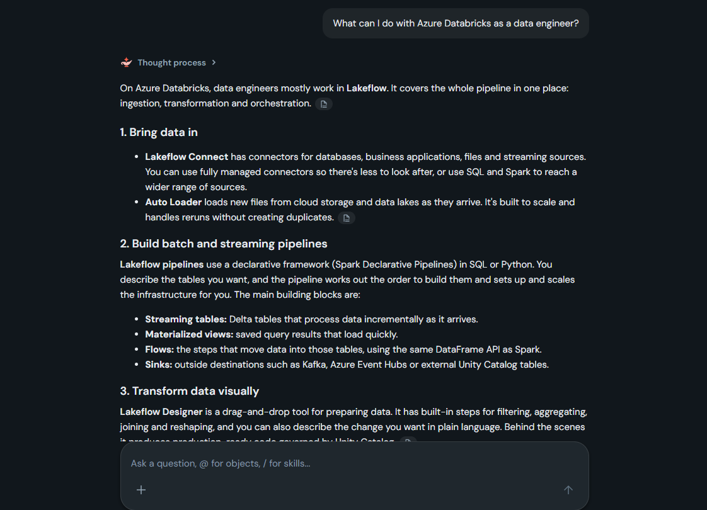
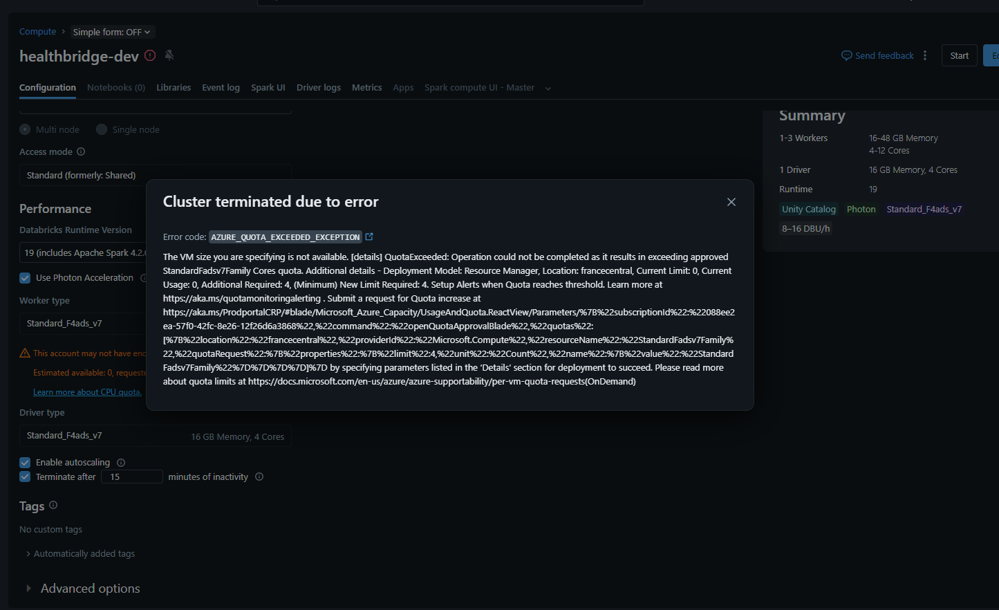

# Laboratorio 02: Seleccionar y Configurar Proceso (Compute) en Azure Databricks

En este laboratorio, trabajarás como ingeniero de datos en HealthBridge Analytics, una organización regional de atención médica que procesa millones de registros de pacientes diariamente. Tu equipo depende de Azure Databricks para ejecutar canalizaciones de ingeniería de datos, análisis ad hoc y cargas de trabajo de validación de canalizaciones.

Antes de que tu equipo pueda procesar cualquier dato, necesitas asegurarte de que los recursos de proceso (compute) correctos estén configurados: un clúster bien ajustado para el desarrollo interactivo y las bibliotecas instaladas correctamente para que tus notebooks tengan las dependencias que necesitan.

Este laboratorio debería tomar aproximadamente **30 minutos** en completarse.

## Requisitos previos

Antes de comenzar este laboratorio, asegúrate de tener:

* Un área de trabajo de Azure Databricks Premium aprovisionada (siguiendo el *Laboratorio 00*).
* Permisos de administrador del metastore, administrador del área de trabajo, o una cuenta de usuario con derechos de creación de clústeres.
* Familiaridad básica con la interfaz del área de trabajo de Azure Databricks.

## Importar el notebook

1. En tu área de trabajo de Azure Databricks, selecciona **Workspace** en la barra lateral izquierda.
2. Navega o crea una carpeta donde desees almacenar el laboratorio.
3. Haz clic en el menú **⋮ (kebab)** junto a la carpeta y selecciona **Import (Importar)**.
4. Elige **URL**, introduce la siguiente URL y selecciona **Import**: `https://raw.githubusercontent.com/MicrosoftLearning/DP-750T00-Implement-Data-Engineering-Solutions-using-Azure-Databricks/refs/heads/main/Allfiles/02-select-and-configure-compute.ipynb`
5. Abre el notebook importado. Lo adjuntarás al proceso sin servidor (Serverless) en un paso posterior.

## Ejercicio 1: Crear y Configurar un Clúster de Propósito General (All-Purpose Cluster)

El equipo de ingeniería de datos de HealthBridge necesita un clúster estándar (compartido) para el desarrollo interactivo. Tu trabajo es crear y configurar este clúster con la configuración adecuada para una carga de trabajo colaborativa de análisis de salud.

### Tarea 1.1: Crear un nuevo clúster de propósito general

1. En la barra lateral izquierda, selecciona **Compute (Proceso)**.
2. Selecciona **Create compute (Crear proceso)**.
3. Cambia el interruptor de formulario simple a **OFF**.
4. En el formulario de creación, configura lo siguiente:
   * **Cluster name:** `healthbridge-dev`
   * **Policy:** Unrestricted
   * **Cluster mode:** Multi node
   * **Access mode:** Standard (anteriormente Compartido)

*No selecciones Crear todavía; continúa con la configuración a continuación.*

### Tarea 1.2: Configurar el rendimiento y la configuración de runtime

Continúa en el formulario de creación del clúster:

1. En **Databricks Runtime version**, selecciona la última versión LTS (Long Term Support).
2. En **Worker type**, selecciona una instancia optimizada para memoria (por ejemplo, una VM de la serie E).
3. En **Worker**, habilita **Autoscaling** y establece:
   * Minimum workers: `1`
   * Maximum workers: `3`
4. En **Auto termination**, habilítalo y establece el tiempo de espera en `15` minutos.
5. Desplázate hacia arriba para confirmar que **Photon Acceleration** está habilitado.
6. Selecciona **Create compute (Crear proceso)**.

> ⚠️ **Nota del usuario:** En este punto (Tarea 1.2) no he podido seguir con la creación del clúster porque no me alcanza la cuota de CPU de mi suscripción de Azure.

## Ejercicio 2: Instalar una Biblioteca a Nivel de Clúster

*Nota: Estos pasos se incluyen como referencia sobre lo que harías una vez que el clúster estuviera en funcionamiento.*

Tu equipo usa la biblioteca `faker` para generar conjuntos de datos sintéticos de pacientes para pruebas de canalizaciones. Debes hacer que esta biblioteca esté disponible para todos los notebooks que se ejecuten en el clúster.

### Tarea 2.1: Instalar faker como biblioteca a nivel de clúster

1. En la página de **Compute**, selecciona el clúster `healthbridge-dev`.
2. Selecciona la pestaña **Libraries**.
3. Selecciona **Install new**.
4. Configura lo siguiente:
   * **Library source:** PyPI
   * **Package:** `faker==40.8.0`
5. Selecciona **Install** y espera a que el estado indique *Installed*.

## Detener o eliminar el clúster

Para evitar costos de proceso innecesarios en caso de que lo hubieras podido arrancar, debes detenerlo o eliminarlo antes de continuar.

1. En la barra lateral izquierda, selecciona **Compute**.
2. Selecciona el clúster `healthbridge-dev`.
3. Selecciona **Terminate (Terminar)** para detenerlo, o en el menú **⋮** selecciona **Delete (Eliminar)** para quitarlo por completo.

## Ejercicio 3: Trabajar con Bibliotecas en un Notebook

Ahora cambiarás al notebook para completar los ejercicios restantes basados en código. 

### Adjuntar el notebook al Proceso Sin Servidor (Serverless)

1. Abre el notebook `02-select-and-configure-compute` que importaste antes.
2. En el selector de proceso en la parte superior del notebook, elige **Serverless compute**.
3. Continúa con los Ejercicios 3 y 4 directamente dentro del notebook (los cuales se ejecutan en Serverless y demuestran la instalación de bibliotecas a nivel de notebook, trabajando de forma independiente de las bibliotecas a nivel de clúster).